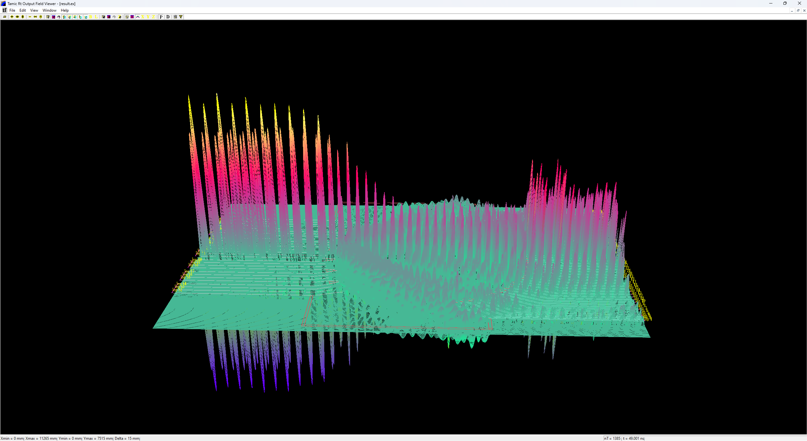
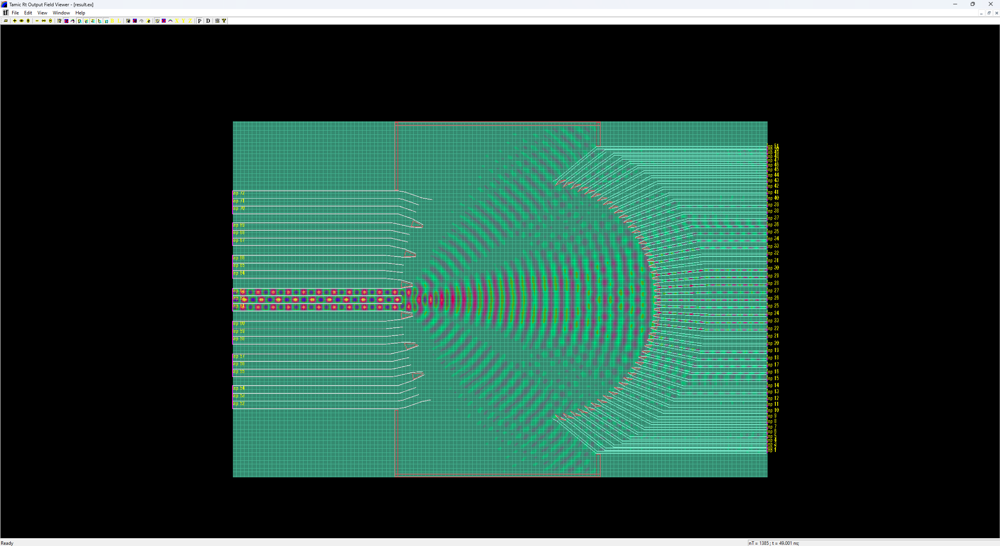
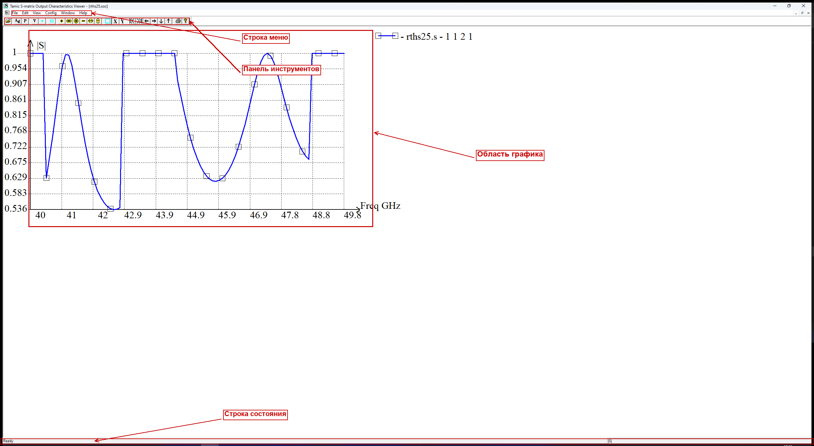
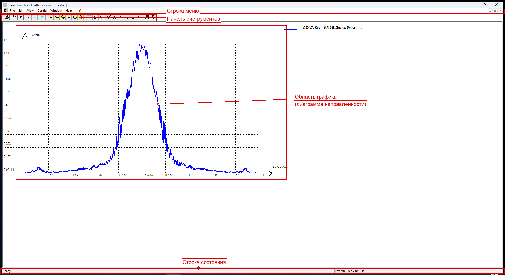
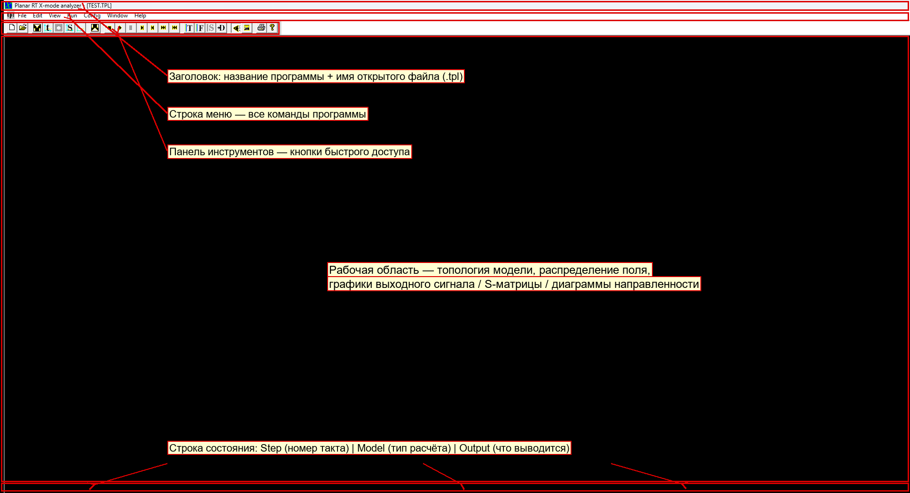

<div align="center">

# TMC Suite

**Scientific software package for electrodynamic simulation of planar structures**

C++ · MFC · OpenGL · Windows (32/64-bit)

**English** · [Русский](#tmc-suite-русская-версия)



</div>

---

## Overview

**TMC Suite** is an authorial scientific software package by **K. N. Klimov** for electrodynamic
computation and visualization of planar structures (H-polarization and X-mode). It computes
scattering matrices, radiation (directional) patterns, time-domain signals and electromagnetic
fields, and provides interactive OpenGL/MFC viewers to explore the results.

The package consists of **6 programs** and **6 libraries**, sharing a single source tree and built
for both **win32** and **win64**.

## Components

### Computational kernels
| Program | Executable | Purpose |
|---|---|---|
| **PlanarRT_H** | `tmc_rth.exe` | Time-domain Rt-network solver, H-polarization |
| **PlanarRT_X** | `tmc_rtx.exe` | Time-domain Rt-network solver, X-mode (incl. magnetized plasma) |

### Viewers & visualization
| Program | Purpose |
|---|---|
| **TMCGROUT** | Scattering-matrix plots |
| **TMC_DN** | Radiation (directional) patterns |
| **TMCROS** | Time-domain signals |
| **FieldView** | Interactive OpenGL visualization of electromagnetic fields |

### Libraries
`SFILE95` · `complex` · `exprint` · `TMCLibError` · `PREPR` · `TMCIndan`

## Screenshots

| Field visualization (FieldView) | Scattering matrix (TMCGROUT) |
|---|---|
|  |  |

| Radiation pattern (TMC_DN) | Solver (PlanarRT_X) |
|---|---|
|  |  |

## Input format

Simulations are described in **`.tpl`** text files (the TAMIC input language): geometry, materials,
sources, frequency sweeps and output requests.

## What's new in 1.3

- **Wideband computation:** the incident wave can be read from a `.sig` file, and the whole band is
  processed in one run (kernel S-matrix and TMCROS).
- **Radiation pattern on the domain border** and multi-frequency radiation patterns.
- **GPU computation** (OpenCL, `/GPU` key, menu *Config → Compute on GPU*, win64).
- **Faster block building** — parallel computation of ε and plasma over the processor cores.
- **Grids and single blocks larger than 2³¹ nodes** — both limits removed: 64-bit grid node indices and
  64-bit block node counters.
- **Computation timing** — `/Time` key and the *Calc. time…* line in the statistics window;
  kernel exit codes 0/1/2/3 and progress output to the console in `/Ar`, `/Arb` modes.
- **171 fixed defects** (Nos. 19–189) — see [`CHANGELOG.md`](CHANGELOG.md) and the closed Issues.
- Code refactoring (dead code and unused files removed, documenting comments), a build without
  warnings, the Apache 2.0 license.

## Download

Ready-made builds are published in [Releases](../../releases):

| File | For |
|---|---|
| `TMC_Suite_Setup.exe` | **most users** — installer with the programs, samples and Start menu shortcuts |
| `TMC_Suite_v1.3_x86.zip` · `_x64.zip` · `_x86-x64.zip` | those who prefer an archive to an installer |

The archives unpack into the ready `dist\win32\bin` and `dist\win64\bin` layout.

## Building (Windows)

The package is built with **Microsoft Visual Studio 2026 / MSBuild** (toolset v145). Source is
shared; build outputs are kept per-platform. The solution `src/tamic.slnx` builds all 12 projects
in dependency order.

```bat
:: win32
msbuild src\tamic.slnx /p:Platform=Win32 /p:Configuration=Release

:: win64
msbuild src\tamic.slnx /p:Platform=x64 /p:Configuration=Release
```

Release output goes to `dist\win32\` and `dist\win64\`, Debug output to `dist\<platform>\debug\`.
The build completes without errors and without warnings in all four configurations.

> **Build order matters** when projects are built one by one: all 6 libraries first, then the
> viewers, then the kernels, then FieldView. See [`BUILD_ORDER.md`](BUILD_ORDER.md).

## Ports to other systems

The package has been ported from Windows/MFC to Qt 6 and to the console. The computational code is
shared: the same Windows source tree, compiled by another compiler, so the numbers stay the same and
the file formats stay compatible in every direction.

| Repository | What it is |
|---|---|
| **this repository** | Windows, the original package — MFC / OpenGL, 32 and 64 bits |
| [TMC Suite for Linux (graphical)](https://github.com/klimov-kn/TMC_Suite_Linux_GUI) | Linux, all six programs on Qt 6 |
| [TMC Suite for Linux (console)](https://github.com/klimov-kn/TMC_Suite_Linux_Console) | Linux, computation kernels without windows |
| [TMC Suite for macOS](https://github.com/klimov-kn/TMC_Suite_MacOS) | macOS, universal build for Apple Silicon and Intel |

## Documentation

Documentation (in Russian) — user manuals, the `.tpl` language reference, the code reference and
the build guide — is published on the project website [www.tamic.ru](https://www.tamic.ru).
Comments in the source code link to the corresponding pages of the website.

## Author & links

- **Author:** K. N. Klimov
- **Website:** [www.tamic.ru](https://www.tamic.ru)
- Social links are provided on the author's profile.

## License

[Apache License 2.0](LICENSE). See also [`NOTICE`](NOTICE).

---
---

<div align="center">

# TMC Suite (русская версия)

**Научный пакет для электродинамического моделирования планарных структур**

C++ · MFC · OpenGL · Windows (32/64 бита)

[English](#tmc-suite) · **Русский**

</div>

## О проекте

**TMC Suite** — авторская научная разработка **К. Н. Климова** для электродинамических расчётов и
визуализации планарных структур (H-поляризация и X-мода). Пакет вычисляет матрицы рассеяния,
диаграммы направленности, временные сигналы и электромагнитные поля, а также предоставляет
интерактивные вьюверы на OpenGL/MFC для просмотра результатов.

Пакет состоит из **6 программ** и **6 библиотек** с единым деревом исходников; собирается под
**win32** и **win64**.

## Состав

### Счётные ядра
| Программа | Исполняемый файл | Назначение |
|---|---|---|
| **PlanarRT_H** | `tmc_rth.exe` | Расчётное ядро (Rt-сети во временной области), H-поляризация |
| **PlanarRT_X** | `tmc_rtx.exe` | Расчётное ядро (Rt-сети во временной области), X-мода (в т.ч. замагниченная плазма) |

### Вьюверы и визуализация
| Программа | Назначение |
|---|---|
| **TMCGROUT** | Графики матриц рассеяния |
| **TMC_DN** | Диаграммы направленности |
| **TMCROS** | Временные сигналы |
| **FieldView** | Интерактивная OpenGL-визуализация электромагнитных полей |

### Библиотеки
`SFILE95` · `complex` · `exprint` · `TMCLibError` · `PREPR` · `TMCIndan`

## Скриншоты

| Визуализация полей (FieldView) | Матрица рассеяния (TMCGROUT) |
|---|---|
|  |  |

| Диаграмма направленности (TMC_DN) | Счётное ядро (PlanarRT_X) |
|---|---|
|  |  |

## Формат входных данных

Задачи описываются в текстовых файлах **`.tpl`** (входной язык TAMIC): геометрия, материалы,
источники, частотные развёртки и запросы на вывод.

## Что нового в версии 1.3

- **Многочастотный расчёт:** падающая волна читается из файла `.sig`, вся полоса обрабатывается
  за один проход (S-матрица в ядре и в TMCROS).
- **Диаграмма направленности по границе области** и многочастотная ДН.
- **Расчёт на видеокарте** (OpenCL, ключ `/GPU`, меню *Config → Compute on GPU*, win64).
- **Ускорение построения блоков** — параллельный расчёт ε и плазмы по ядрам процессора.
- **Сетки и отдельные блоки больше 2³¹ узлов** — сняты оба ограничения: 64-битные индексы узлов сетки
  и счётчики узлов блока.
- **Замер времени расчёта** — ключ `/Time` и строка *Calc. time…* в окне статистики; коды возврата
  ядер 0/1/2/3 и вывод хода расчёта в консоль в режимах `/Ar`, `/Arb`.
- **171 исправленный дефект** (№ 19–189) — см. [`CHANGELOG.md`](CHANGELOG.md) и закрытые Issues.
- Рефакторинг кода (удалены мёртвый код и неиспользуемые файлы, документирующие комментарии),
  сборка без предупреждений, лицензия Apache 2.0.

## Загрузка

Готовые сборки опубликованы в разделе [Releases](../../releases):

| Файл | Кому |
|---|---|
| `TMC_Suite_Setup.exe` | **большинству пользователей** — установщик с программами, образцами заданий и ярлыками в меню «Пуск» |
| `TMC_Suite_v1.3_x86.zip` · `_x64.zip` · `_x86-x64.zip` | кто предпочитает архив установщику |

Архивы разворачиваются в готовую структуру `dist\win32\bin` и `dist\win64\bin`.

## Сборка (Windows)

Пакет собирается в **Microsoft Visual Studio 2026 / MSBuild** (набор инструментов v145). Исходники
общие, результаты сборки — раздельные по платформам. Решение `src/tamic.slnx` собирает все
12 проектов в порядке зависимостей.

```bat
:: win32
msbuild src\tamic.slnx /p:Platform=Win32 /p:Configuration=Release

:: win64
msbuild src\tamic.slnx /p:Platform=x64 /p:Configuration=Release
```

Release кладёт файлы в `dist\win32\` и `dist\win64\`, Debug — в `dist\<платформа>\debug\`.
Сборка проходит без ошибок и без предупреждений во всех четырёх конфигурациях.

> **Важен порядок сборки**, если проекты собираются по одному: сначала все 6 библиотек, затем
> вьюверы, затем счётные ядра, затем FieldView. См. [`BUILD_ORDER.md`](BUILD_ORDER.md).

## Сборки для других систем

Пакет перенесён с Windows/MFC на Qt 6 и в консоль. Вычислительный код общий: те же исходники
Windows-версии, скомпилированные другим компилятором, — числа остаются теми же, а форматы файлов
совместимы во всех направлениях.

| Репозиторий | Что это |
|---|---|
| **этот репозиторий** | Windows, исходный пакет — MFC / OpenGL, 32 и 64 бита |
| [TMC Suite для Linux (графический)](https://github.com/klimov-kn/TMC_Suite_Linux_GUI) | Linux, все шесть программ на Qt 6 |
| [TMC Suite для Linux (консоль)](https://github.com/klimov-kn/TMC_Suite_Linux_Console) | Linux, счётные ядра без окон |
| [TMC Suite для macOS](https://github.com/klimov-kn/TMC_Suite_MacOS) | macOS, универсальная сборка для Apple Silicon и Intel |

## Документация

Документация на русском языке — руководства пользователя, справочник языка `.tpl`, описание кода
и инструкция по сборке — публикуется на сайте проекта [www.tamic.ru](https://www.tamic.ru).
Комментарии в исходном коде ссылаются на соответствующие страницы сайта.

## Автор и ссылки

- **Автор:** К. Н. Климов
- **Сайт:** [www.tamic.ru](https://www.tamic.ru)
- Ссылки на соцсети указаны в профиле автора.

## Лицензия

[Лицензия Apache 2.0](LICENSE). См. также [`NOTICE`](NOTICE).
