<div align="center">

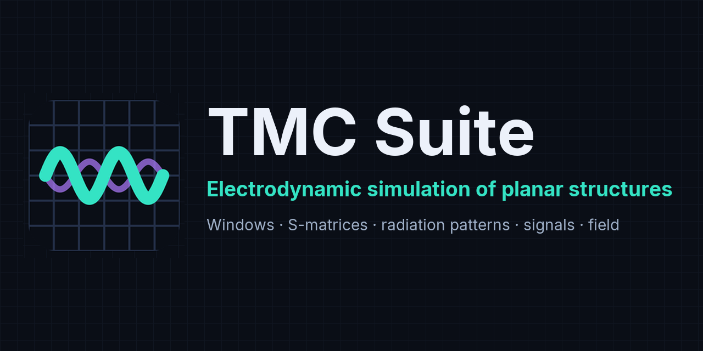

# TMC Suite

**Scientific software package for electrodynamic simulation of planar structures**

C++ · Qt 6 · Windows (64-bit)

**English** · [Русский](#tmc-suite-русская-версия)

</div>

---

## Overview

**TMC Suite** is an authorial scientific software package by **K. N. Klimov** for electrodynamic
computation and visualization of planar structures (H-polarization and X-mode). It computes
scattering matrices, radiation (directional) patterns, time-domain signals and electromagnetic
fields, and provides interactive viewers to explore the results.

The package consists of **7 programs** and **6 libraries** sharing a single source tree. Version 5
is the Qt 6 edition: the interface is new, while the computational code is that of the MFC edition,
so the file formats stay compatible. The last MFC edition is version
[1.3](../../releases/tag/v1.3), its code is in the [`mfc`](../../tree/mfc) branch.

## Components

### Computational kernels
| Program | Executable | Purpose |
|---|---|---|
| **PlanarRT_H** | `planarrt_h.exe` | Time-domain Rt-network solver, H-polarization |
| **PlanarRT_X** | `planarrt_x.exe` | Time-domain Rt-network solver, X-mode (incl. magnetized plasma) |

### Viewers & tools
| Program | Executable | Purpose |
|---|---|---|
| **TMCGROUT** | `tmcgrout.exe` | Scattering-matrix plots |
| **TMC_DN** | `tmc_dn.exe` | Radiation (directional) patterns |
| **TMCROS** | `tmcros.exe` | Time-domain signals |
| **FieldView** | `fieldview.exe` | Interactive visualization of electromagnetic fields (Qt RHI) |
| **TPL Designer** | `TplDesigner.exe` | Visual editor of `.tpl` tasks, import of STEP, STL and OBJ models |

### Libraries
`SFILE95` · `complex` · `exprint` · `TMCLibError` · `PREPR` · `TMCIndan`

## Screenshots

| Field visualization (FieldView) | Task editor (TPL Designer) |
|---|---|
|  | 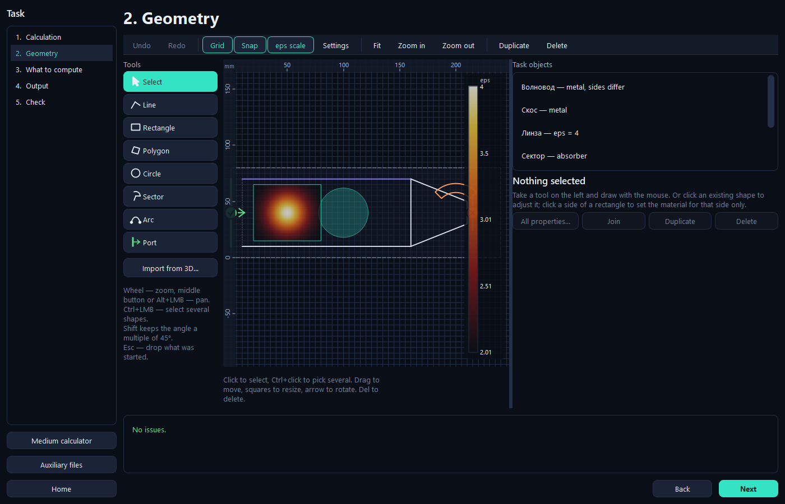 |

| Scattering matrix (TMCGROUT) | Radiation pattern (TMC_DN) |
|---|---|
| 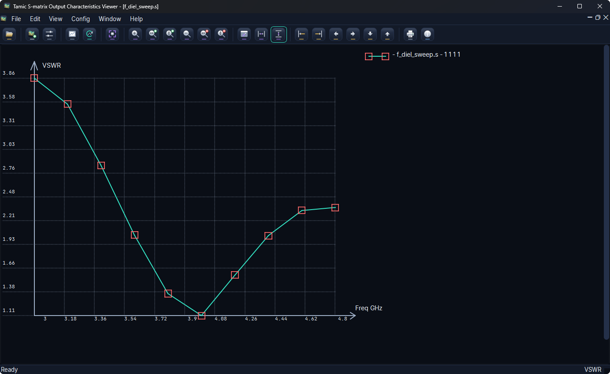 | 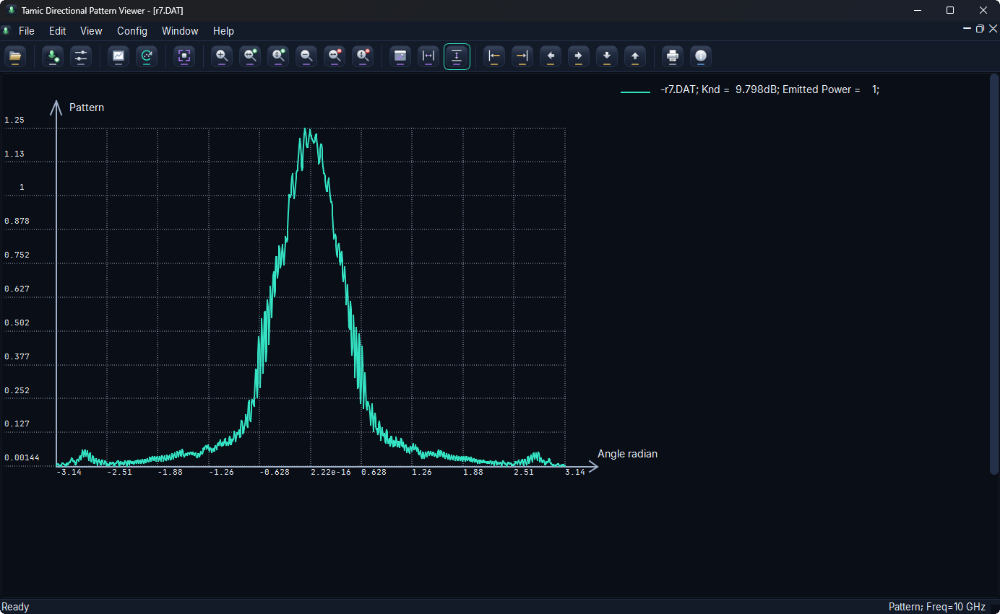 |

| Signals (TMCROS) | Solver at work (PlanarRT_H, on a video card) |
|---|---|
| 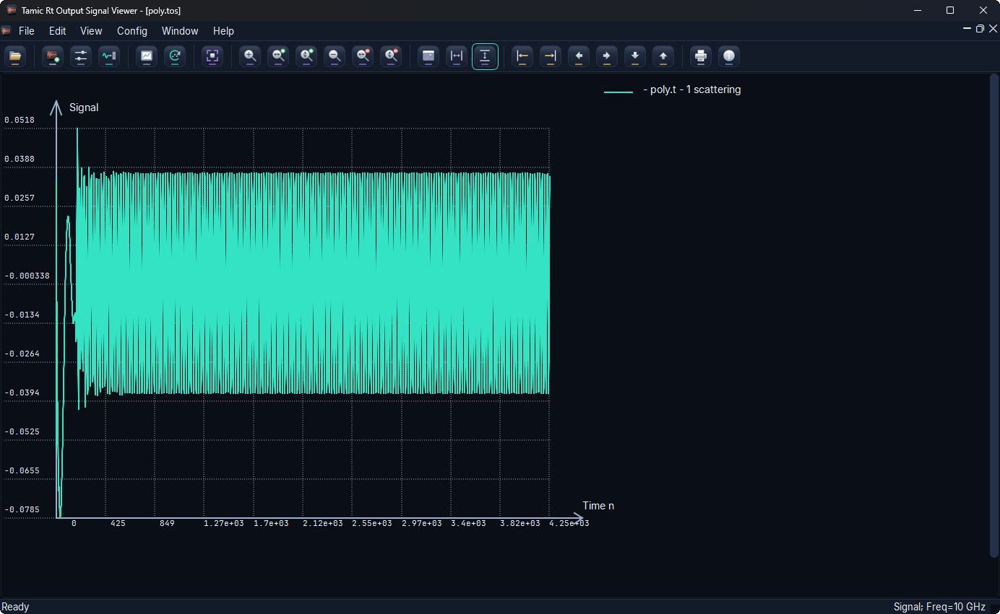 | 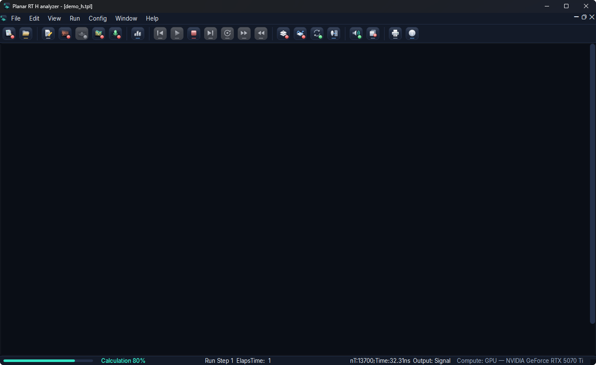 |

## Installation

Both builds are in [Releases](../../releases). Windows 10 or 11, 64-bit; about 220 MB of disk space.
Nothing else has to be installed: everything the programs need is inside.

**Installer** — `TMC_Suite_5.0_Qt6_Setup.exe`:

1. Run the file. If SmartScreen appears, press **More info**, then **Run anyway**: the installer is
   not signed with a paid certificate.
2. Choose *for all users* (administrator rights, `C:\Program Files\TMC Suite Qt`) or *for me only*
   (no rights needed, `%LOCALAPPDATA%\Programs\TMC Suite Qt`).
3. Follow the wizard. If the package is already installed, the wizard offers to update it.

**Archive, no installation** — `TMC_Suite_5.0_win64.zip`: unpack it to any folder you can write to
and start the programs from there, for example `TplDesigner.exe` or `planarrt_h.exe`. Examples and
manuals in Russian and English are inside.

Step-by-step installation with screenshots:
[www.tamic.ru](https://www.tamic.ru/docs/install/windows-qt6.html).

## Running a calculation from the console

The kernels calculate a task without user actions and report to the console. Give the full path to
the task: its folder is where the included files are looked for and the results are written.

```bat
"C:\Program Files\TMC Suite Qt\planarrt_h.exe" "D:\calc\horn.tpl" /Arb /Time
```

If the package is not installed, unpack the archive and use the path to `planarrt_h.exe` there. In a
batch file the command waits for the end of the calculation; in an interactive `cmd` window start it
with `start /wait "" "...\planarrt_h.exe" "D:\calc\horn.tpl" /Arb`.

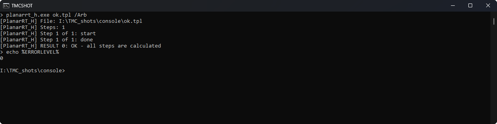

| Key | What it does |
|---|---|
| `/Arb` | calculate all steps and always close the window at the end |
| `/Ar` | calculate all steps; after an error the window stays open |
| `/Time` | write the calculation time report next to the task |
| `/GPU`, `/GPU:n` | calculate on the video card, or on card number `n` (from 0) |
| `/CPU` | calculate on the processor, even if the video card is switched on in the settings |

| Exit code | Meaning |
|---|---|
| 0 | all steps are calculated |
| 1 | error in the task |
| 2 | error during the calculation (the sweep is calculated to the end) |
| 3 | the calculation was stopped |

`planarrt_x.exe` works in the same way. Details:
[www.tamic.ru](https://www.tamic.ru/docs/user-manual/console-mode.html).

## Video card

The main part of the calculation can run on a video card, up to tens of times faster on large grids.
The numbers do not change: the card gives the same results as the processor, bit for bit.

| Item | Details |
|---|---|
| Video card | any card with **OpenCL 1.2** and **double precision** (`cl_khr_fp64`), with a current driver |
| Memory on the card | about 32 bytes per node for H and 96 bytes per node for X; 16 GB hold about 449 and 149 million nodes |
| How to switch on | **Config → Compute (GPU)**: the window checks the card and estimates the speed-up for your machine |
| From the console | keys `/GPU`, `/GPU:n`, `/CPU` |
| Measured speed-up | ×10–12 on 1 million nodes, up to ×36 on tens of millions (one test machine, RTX 5070 Ti) |
| Stays on the processor | small grids, and grids that do not fit into the card's memory; the time report gives the reason |

Tasks with field output are sped up less: the whole grid is copied from the card.

## Input format

Simulations are described in **`.tpl`** text files (the TAMIC input language): geometry, materials,
sources, frequency sweeps and output requests. TPL Designer creates such files in a visual editor.

## What's new in 5.0

- **New interface on Qt 6** for all programs, with Russian and English languages.
- **FieldView** draws fields through Qt RHI (Direct3D 11 or OpenGL).
- **TPL Designer** is now part of the package.
- **Everything built by one command** with MinGW and CMake.
- Code refactoring (dead code and unused files removed, every file, class and function documented
  with links to the website), a build without errors and warnings.

## Building (Windows)

The package is built with **MinGW 13.1**, **Qt 6.11** and **Open CASCADE Technology** (STEP import in
TPL Designer), using CMake and Ninja:

```sh
OCCT_DIR=<folder with OpenCASCADEConfig.cmake> build/build_win.sh
```

Programs go to `dist/win64/bin`, libraries to `dist/win64/lib`, intermediate files to `build/obj`.
The build completes without errors and without warnings. See [`BUILD_ORDER.md`](BUILD_ORDER.md).

## Other systems

| Repository | What it is |
|---|---|
| **this repository** | Windows, Qt 6, 64 bits |
| [TMC Suite for Linux (graphical)](https://github.com/klimov-kn/TMC_Suite_Linux_GUI) | Linux, all six programs on Qt 6 |
| [TMC Suite for Linux (console)](https://github.com/klimov-kn/TMC_Suite_Linux_Console) | Linux, computation kernels without windows |
| [TMC Suite for macOS](https://github.com/klimov-kn/TMC_Suite_MacOS) | macOS, universal build for Apple Silicon and Intel |

## Documentation

Documentation in Russian and English — user manuals, the `.tpl` language reference, the code
reference and the build guide — is published on the project website
[www.tamic.ru](https://www.tamic.ru). Comments in the source code link to the corresponding pages.

## Author & links

- **Author:** K. N. Klimov
- **Website:** [www.tamic.ru](https://www.tamic.ru)
- Social links are provided on the author's profile.

## License

[Apache License 2.0](LICENSE). See also [`NOTICE`](NOTICE).

---
---

<div align="center">

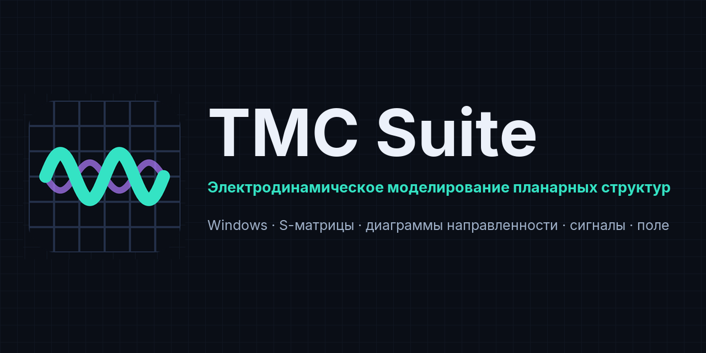

# TMC Suite (русская версия)

**Научный пакет для электродинамического моделирования планарных структур**

C++ · Qt 6 · Windows (64 бита)

[English](#tmc-suite) · **Русский**

</div>

## О проекте

**TMC Suite** — авторская научная разработка **К. Н. Климова** для электродинамических расчётов и
визуализации планарных структур (H-поляризация и X-мода). Пакет вычисляет матрицы рассеяния,
диаграммы направленности, временные сигналы и электромагнитные поля, а также предоставляет
интерактивные вьюверы для просмотра результатов.

Пакет состоит из **7 программ** и **6 библиотек** с единым деревом исходников. Версия 5 — издание
на Qt 6: интерфейс новый, а расчётный код — из издания на MFC, поэтому форматы файлов совместимы.
Последнее издание на MFC — версия [1.3](../../releases/tag/v1.3), её код — в ветке
[`mfc`](../../tree/mfc).

## Состав

### Счётные ядра
| Программа | Исполняемый файл | Назначение |
|---|---|---|
| **PlanarRT_H** | `planarrt_h.exe` | Расчётное ядро (Rt-сети во временной области), H-поляризация |
| **PlanarRT_X** | `planarrt_x.exe` | Расчётное ядро (Rt-сети во временной области), X-мода (в т.ч. замагниченная плазма) |

### Вьюверы и средства
| Программа | Исполняемый файл | Назначение |
|---|---|---|
| **TMCGROUT** | `tmcgrout.exe` | Графики матриц рассеяния |
| **TMC_DN** | `tmc_dn.exe` | Диаграммы направленности |
| **TMCROS** | `tmcros.exe` | Временные сигналы |
| **FieldView** | `fieldview.exe` | Интерактивная визуализация электромагнитных полей (Qt RHI) |
| **TPL Designer** | `TplDesigner.exe` | Визуальный редактор заданий `.tpl`, импорт моделей STEP, STL и OBJ |

### Библиотеки
`SFILE95` · `complex` · `exprint` · `TMCLibError` · `PREPR` · `TMCIndan`

## Скриншоты

| Визуализация полей (FieldView) | Редактор заданий (TPL Designer) |
|---|---|
| 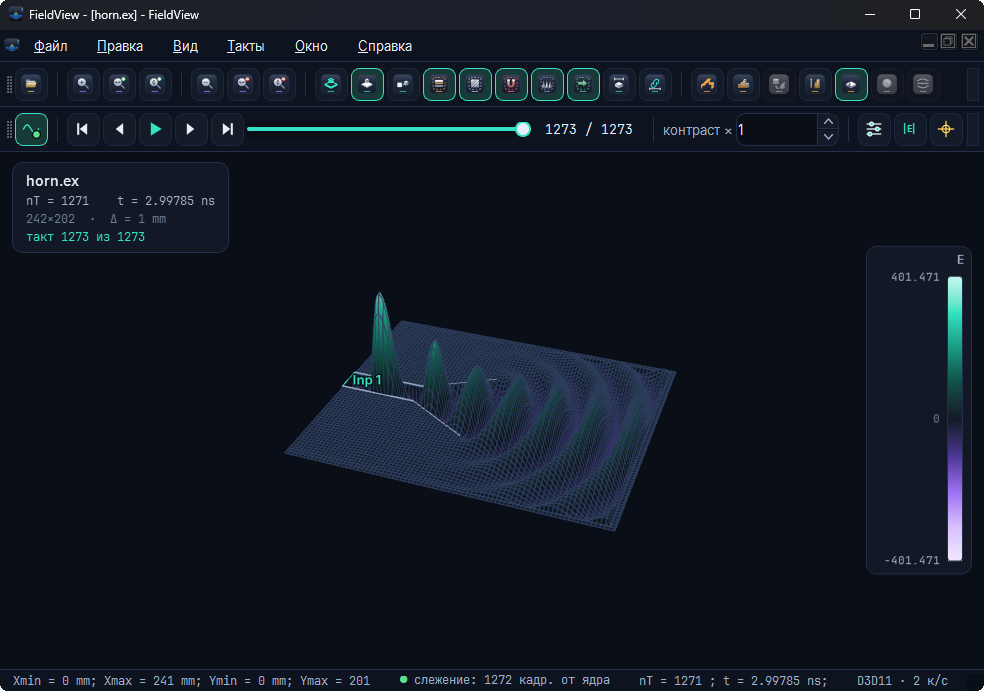 | 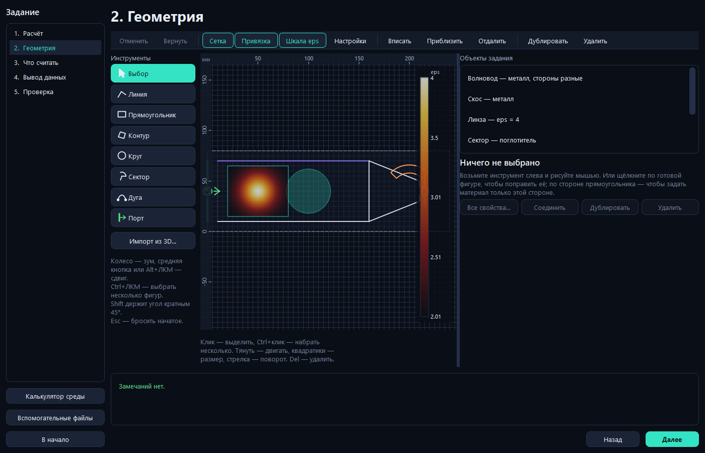 |

| Матрица рассеяния (TMCGROUT) | Диаграмма направленности (TMC_DN) |
|---|---|
| 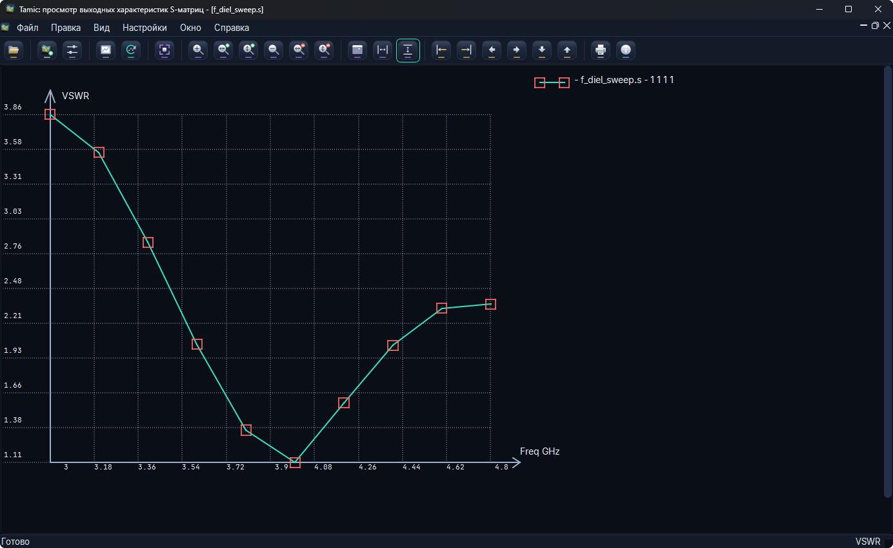 | 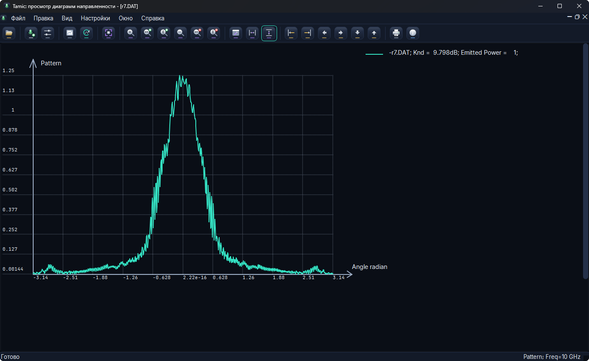 |

| Сигналы (TMCROS) | Счётное ядро за работой (PlanarRT_H, на видеокарте) |
|---|---|
| 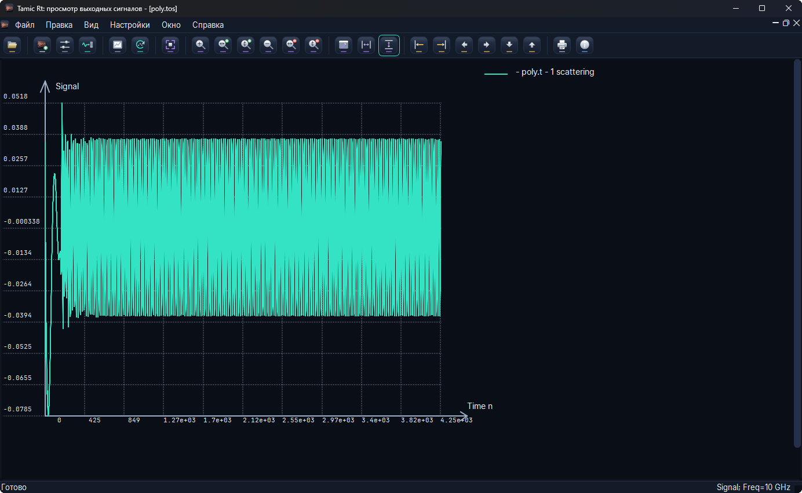 | 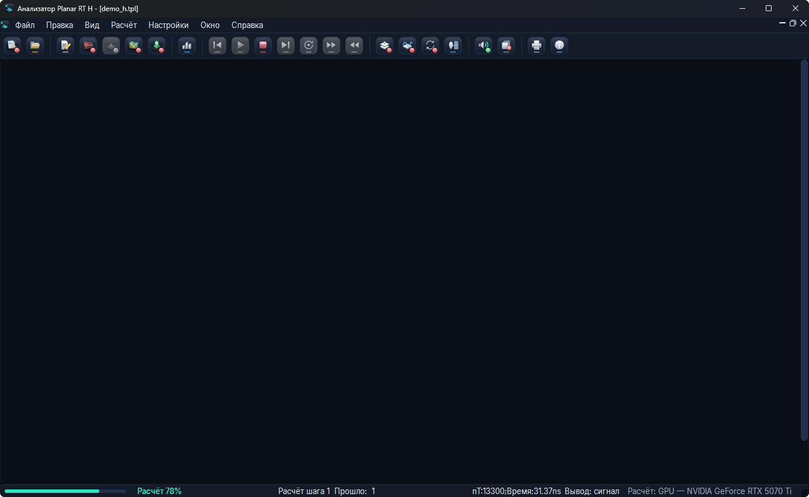 |

## Установка

Обе поставки — в разделе [Releases](../../releases). Нужны Windows 10 или 11, 64 бита, и около 220 МБ
на диске. Больше ничего ставить не надо: всё необходимое для работы программ уже внутри.

**Установщик** — `TMC_Suite_5.0_Qt6_Setup.exe`:

1. Запустите файл. Если появится окно SmartScreen, нажмите **Подробнее**, затем **Выполнить в любом
   случае**: установщик не подписан платным сертификатом.
2. Выберите установку *для всех пользователей* (нужны права администратора,
   `C:\Program Files\TMC Suite Qt`) или *только для меня* (права не нужны,
   `%LOCALAPPDATA%\Programs\TMC Suite Qt`).
3. Следуйте шагам мастера. Если пакет уже установлен, мастер предложит обновить его.

**Архив без установки** — `TMC_Suite_5.0_win64.zip`: распакуйте в любую папку, куда можно писать, и
запускайте программы прямо оттуда, например `TplDesigner.exe` или `planarrt_h.exe`. Внутри — примеры и
руководства на русском и английском.

Пошаговая установка со снимками:
[www.tamic.ru](https://www.tamic.ru/docs/install/windows-qt6.html).

## Запуск расчёта из консоли

Ядра считают задание без участия пользователя и сообщают ход расчёта в консоль. Путь к заданию
указывайте полным: в его папке ищутся включаемые файлы и туда пишутся результаты.

```bat
"C:\Program Files\TMC Suite Qt\planarrt_h.exe" "D:\calc\horn.tpl" /Arb /Time
```

Если пакет не установлен, распакуйте архив и укажите путь к `planarrt_h.exe` в нём. В bat-файле команда
ждёт конца расчёта; в окне `cmd` запускайте так:
`start /wait "" "...\planarrt_h.exe" "D:\calc\horn.tpl" /Arb`.


| Ключ | Что делает |
|---|---|
| `/Arb` | посчитать все шаги и всегда закрыть окно в конце |
| `/Ar` | посчитать все шаги; при ошибке окно остаётся открытым |
| `/Time` | записать рядом с заданием отчёт о времени расчёта |
| `/GPU`, `/GPU:n` | считать на видеокарте или на карте с номером `n` (с нуля) |
| `/CPU` | считать на процессоре, даже если видеокарта включена в настройках |

| Код завершения | Значение |
|---|---|
| 0 | все шаги посчитаны |
| 1 | ошибка в задании |
| 2 | ошибка во время расчёта (свип считается до конца) |
| 3 | расчёт остановлен |

`planarrt_x.exe` работает так же. Подробнее —
[www.tamic.ru](https://www.tamic.ru/docs/user-manual/console-mode.html).

## Видеокарта

Основная часть расчёта может идти на видеокарте: на больших сетках это ускоряет счёт в десятки раз.
Числа при этом не меняются: видеокарта даёт те же результаты, что и процессор, бит в бит.

| Что | Подробности |
|---|---|
| Видеокарта | любая с **OpenCL 1.2** и **двойной точностью** (`cl_khr_fp64`), со свежим драйвером |
| Память на карте | примерно 32 байта на узел для H и 96 байт на узел для X; в 16 ГБ помещается около 449 и 149 млн узлов |
| Как включить | **Настройки → Расчёт на видеокарте**: окно проверит карту и оценит ускорение на вашей машине |
| Из консоли | ключи `/GPU`, `/GPU:n`, `/CPU` |
| Измеренное ускорение | ×10–12 на 1 млн узлов, до ×36 на десятках миллионов (один проверочный компьютер, RTX 5070 Ti) |
| Остаётся на процессоре | малые сетки и сетки, которые не помещаются в память карты; причину называет отчёт о времени |

Задания с выводом поля ускоряются слабее: с карты копируется вся сетка.

## Формат входных данных

Задачи описываются в текстовых файлах **`.tpl`** (входной язык TAMIC): геометрия, материалы,
источники, частотные развёртки и запросы на вывод. TPL Designer создаёт такие файлы в визуальном
редакторе.

## Что нового в версии 5.0

- **Новый интерфейс на Qt 6** во всех программах, русский и английский языки.
- **FieldView** рисует поля через Qt RHI (Direct3D 11 или OpenGL).
- **TPL Designer** вошёл в пакет.
- **Сборка всего пакета одной командой** (MinGW, CMake).
- Рефакторинг кода (удалены мёртвый код и неиспользуемые файлы; описаны все файлы, классы и функции,
  со ссылками на сайт), сборка без ошибок и предупреждений.

## Сборка (Windows)

Пакет собирается **MinGW 13.1**, **Qt 6.11** и **Open CASCADE Technology** (импорт STEP в
TPL Designer) с помощью CMake и Ninja:

```sh
OCCT_DIR=<папка с OpenCASCADEConfig.cmake> build/build_win.sh
```

Программы — в `dist/win64/bin`, библиотеки — в `dist/win64/lib`, промежуточные файлы — в `build/obj`.
Сборка проходит без ошибок и без предупреждений. Подробнее — [`BUILD_ORDER.md`](BUILD_ORDER.md).

## Другие системы

| Репозиторий | Что это |
|---|---|
| **этот репозиторий** | Windows, Qt 6, 64 бита |
| [TMC Suite для Linux (графическая)](https://github.com/klimov-kn/TMC_Suite_Linux_GUI) | Linux, все шесть программ на Qt 6 |
| [TMC Suite для Linux (консольная)](https://github.com/klimov-kn/TMC_Suite_Linux_Console) | Linux, счётные ядра без окон |
| [TMC Suite для macOS](https://github.com/klimov-kn/TMC_Suite_MacOS) | macOS, универсальная сборка для Apple Silicon и Intel |

## Документация

Документация на русском и английском — руководства пользователя, справочник языка `.tpl`,
справочник по коду и инструкция по сборке — опубликована на сайте проекта
[www.tamic.ru](https://www.tamic.ru). Комментарии в исходном коде ссылаются на страницы сайта.

## Автор и ссылки

- **Автор:** К. Н. Климов
- **Сайт:** [www.tamic.ru](https://www.tamic.ru)
- Ссылки на профили — в профиле автора.

## Лицензия

[Apache License 2.0](LICENSE). См. также [`NOTICE`](NOTICE).
